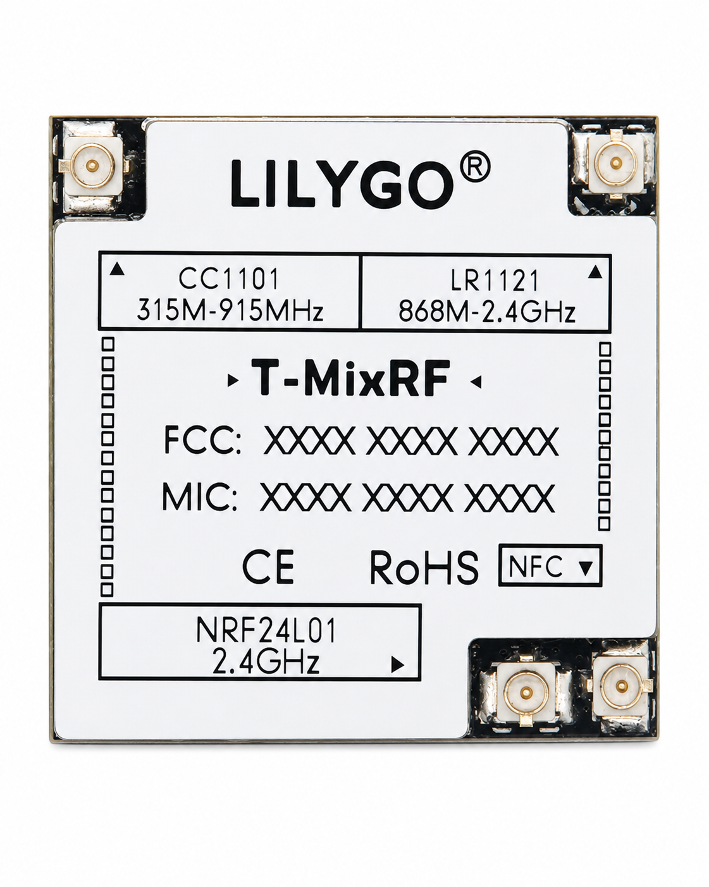

# T-MixRF Multi-Protocol RF Module

 

| Front | Back |
| :---: | :---: |
|  | .png) | 

T-MixRF  is a multi-protocol RF front-end module integrating Sub-GHz, 2.4 GHz, and 13.56 MHz NFC circuits. **The module does not contain any host MCU** and must be connected to an external ESP32, STM32, Linux host, or another SPI-capable controller.

> **Important: this is an RF module only; it cannot run independently.**
>
> There is no ESP32, Flash, PSRAM, USB converter, or user program on the board. The external host must provide the SPI bus, GPIOs, interrupt handling, and protocol software.

## Feature overview

| RF device | Main functions | Frequency range / bands | Antenna interface |
| --- | --- | --- | --- |
| **LR1121** | Long-range LoRa and FSK communication on Sub-GHz/2.4 GHz | 150–960 MHz; 1.9–2.2 GHz; 2.4–2.5 GHz, subject to chip configuration | `LR1121-ANT`, RF matching network and IPEX interface |
| **CC1101** | Low-power Sub-GHz FSK/OOK/ASK communication | 300–348 MHz, 387–464 MHz, 779–928 MHz; commonly 315/433/868/915 MHz | `CC1101 ANT`, with SW0/SW1 band selection |
| **nRF24L01** | 2.4 GHz GFSK, auto-acknowledgement and multi-node links | 2.400–2.525 GHz | `NRF-ANT 2.4G` |
| **ST25R3916** | NFC/RFID reading, writing, card emulation and peer-to-peer communication | 13.56 MHz | NFC1/NFC2 antenna terminals; connect a suitable NFC coil |

### LR1121

LR1121 covers Sub-GHz and 2.4 GHz operation for LoRa/LoRaWAN nodes, long-range telemetry, and FSK links. The chip data sheet specifies up to 22 dBm in Sub-GHz mode and 13 dBm at 2.4 GHz. Actual output depends on supply voltage, frequency, modulation, antenna matching, and local regulations.

### CC1101

CC1101 targets low-power short- and medium-range Sub-GHz links and supports FSK, GFSK, MSK, and OOK/ASK modulation. `CC1101-SW0` and `CC1101-SW1` control the RF switch and select the matching network for the desired band; they are not general-purpose buttons or serial signals.

### nRF24L01

nRF24L01 uses 2.4 GHz GFSK and provides hardware auto-acknowledgement, automatic retransmission, address filtering, and multiple receive pipes. It is suitable for remote controls, sensor networks, and low-latency point-to-point links. It shares the SPI bus with the other devices but uses its own control signals.

### ST25R3916

ST25R3916 is a 13.56 MHz NFC transceiver for ISO/IEC 14443A/B, ISO/IEC 15693, NFC-F (selected modes), NFC-V, and NFCIP-1 applications. It supports tag reading/writing, card or tag emulation, and peer-to-peer communication. An external or custom NFC coil must be tuned for the intended operating distance and environment.

## Power and electrical characteristics

- The module accepts **5 V** input and provides approximately **3.3 V** for the RF devices through its onboard power circuitry.
- Digital interfaces use **3.3 V logic**. Do not connect 5 V GPIO directly to SPI or control signals.
- `5V`, `3.3V`, and `GND` pads are exposed. Connect the external host ground and provide enough transient current for transmission.
- Current consumption during transmission depends on frequency, output power, duty cycle, and antenna VSWR.
- USB, firmware download, reset management, and protocol stacks are handled by the external host, not by this module.

## Antenna and RF precautions

1. Use an antenna for the correct band, normally with a 50 Ω interface, and connect it to the matching IPEX connector or pad. Do not directly connect antenna ports from different RF devices.
2. CC1101 SW0/SW1 settings must match the selected band and matching network. Recheck matching and regulatory requirements when changing between 315, 433, 868, and 915 MHz antennas.
3. Do not transmit for extended periods without an antenna or with severe impedance mismatch.
4. The NFC antenna requires tuning. Metal, enclosures, batteries, and PCB mounting can shift the resonance and reduce communication range.
5. Frequency, transmit power, duty cycle, and product certification must comply with local radio regulations.

## Software and examples

The examples demonstrate how an external host can drive each device:

| Directory | Contents |
| --- | --- |
| `examples/LR1121_send`, `LR1121_recv` | LR1121 transmit and receive tests |
| `examples/CC1101_send`, `CC1101_recv` | CC1101 transmit and receive tests |
| `examples/NRF24_send_1`, `NRF24_recv_1`, `NRF24_send_2` | nRF24L01 basic and extended communication |
| `examples/NFC`, `examples/ST25R3916_test` | NFC tag, NDEF, and ST25R3916 tests |
| `examples/rf_test` | Combined multi-RF test |

Driver libraries are included under `lib/`: `RadioLib`, `RF24-master`, and `NFC-RFAL-fork`. Adapt the SPI instance, GPIOs, interrupt service routines, and power-control logic for your host board.

## Hardware resources

- Schematic: [`hardware/T-MixRF V1.1.pdf`](./hardware/T-MixRF%20V1.1.pdf)
- Pad and interface labels: [`docs/README_img/T-MixRF_标识(1).png`](./docs/README_img/T-MixRF_标识(1).png)
- Examples: [`examples/`](./examples/)
- Chinese documentation: [`README_CN.md`](README_CN.md)
