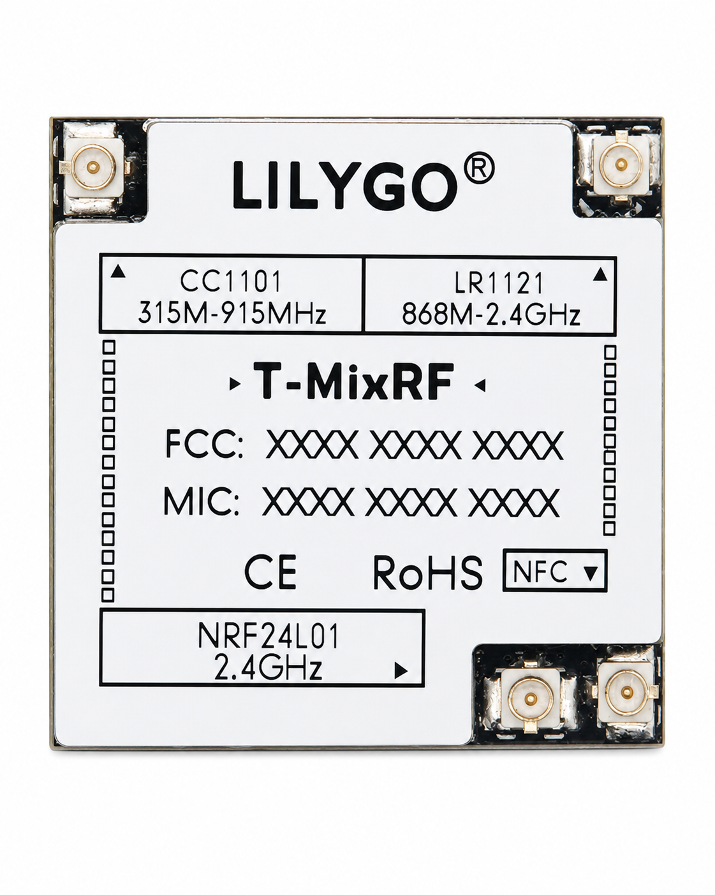

# T-MixRF 多协议射频模块

 

| Front | Back |
| :---: | :---: |
|  | .png) | 

T-MixRF 是一块多协议射频前端模块，集成 Sub-GHz、2.4 GHz 和 13.56 MHz NFC 射频电路。模块本身不包含任何主控芯片，需连接外部 ESP32、STM32、Linux 主机或其他带 SPI 的控制器后才能使用。

> **重要说明：本板只是射频模块，不包含主控芯片。**
>
> 板上没有 ESP32、Flash、PSRAM、USB 转换器或用户程序，无法单独运行。用户需要自行提供主控、SPI 总线、GPIO、中断处理和协议软件，并按照实际接线修改示例程序中的引脚定义。

## 功能概览

| 射频器件 | 主要功能 | 频率范围/频点 | 天线接口 |
| --- | --- | --- | --- |
| **LR1121** | LoRa、FSK 等远距离 Sub-GHz/2.4 GHz 通信 | 150–960 MHz；1.9–2.2 GHz；2.4–2.5 GHz（具体取决于芯片配置） | `LR1121-ANT`，板上射频匹配网络及 IPEX 接口 |
| **CC1101** | 低功耗 Sub-GHz FSK/OOK/ASK 等通信 | 芯片支持 300–348 MHz、387–464 MHz、779–928 MHz，常用 315/433/868/915 MHz | `CC1101 ANT`，通过 SW0/SW1 选择匹配网络 |
| **nRF24L01** | 2.4 GHz GFSK 收发、自动应答和多节点通信 | 2.400–2.525 GHz | `NRF-ANT 2.4G` |
| **ST25R3916** | NFC/RFID 读写、卡模拟和点对点通信 | 13.56 MHz | NFC1/NFC2 天线端，需连接合适的 NFC 线圈/天线 |

### LR1121

LR1121 是本模块的远距离无线收发器，可覆盖 Sub-GHz 和 2.4 GHz 频段。芯片数据手册给出的最大发射功率为 Sub-GHz 22 dBm、2.4 GHz 13 dBm；实际输出会受到供电、频点、调制方式、天线和法规限制影响。可用于 LoRa/LoRaWAN 节点、远距离遥测、FSK 数据链路等场景。

### CC1101

CC1101 面向低功耗短距或中距 Sub-GHz 链路，支持常见的 FSK、GFSK、MSK、OOK/ASK 调制。板上 `CC1101-SW0` 和 `CC1101-SW1` 用于控制射频开关，选择不同频段的匹配网络；它们不是普通的用户按键或串口信号，切换频点时应按原理图和天线配置设置。

### nRF24L01

nRF24L01 使用 2.4 GHz GFSK，带有硬件自动应答、自动重发、地址过滤和多接收管道，适合遥控器、传感器网络和低延迟点对点通信。模块通过独立的 CSN、CE 和 IRQ 信号连接主控，和其他器件共用 SPI 数据线。

### ST25R3916

ST25R3916 是 13.56 MHz NFC 高集成收发器，可用于 ISO/IEC 14443A/B、ISO/IEC 15693、NFC-F（部分模式）、NFC-V 以及 NFCIP-1 等应用，支持标签读写、卡/标签模拟和点对点通信。NFC 天线需要根据工作距离和目标卡片自行设计或连接匹配好的外部线圈；NFC 性能与线圈尺寸、匹配元件、金属环境和调谐结果密切相关。

## 供电与电气参数

- 模块输入为 **5 V**，板载 DC-DC/LDO 射频供电电路将其转换为约 **3.3 V**。
- 各射频芯片的数字接口采用 **3.3 V 电平**。请勿将 5 V GPIO 直接连接到 SPI 或控制信号。
- `5V`、`3.3V` 和 `GND` 焊盘均已引出。接入外部主控时必须共地，并确认主控能够提供足够的瞬态电流。
- 发射时的电流与频点、发射功率、占空比和天线驻波有关，不能仅按静态待机电流选择电源。
- 模块不负责 USB、下载、复位管理或协议栈运行；这些功能由外部主控系统完成。

## 天线与射频使用注意事项

1. 使用对应频段、阻抗通常为 50 Ω 的天线，并将天线接到匹配的 IPEX/焊盘，避免把不同射频芯片的天线端直接相连。
2. CC1101 的 SW0/SW1 必须与目标频段和匹配网络一致；更换 315、433、868 或 915 MHz 天线后应重新检查匹配和法规要求。
3. LR1121、CC1101 和 nRF24L01 发射时不要在无天线或严重失配状态下长时间工作，以免降低性能或损坏功放。
4. NFC 天线需要调谐。线圈附近的金属、外壳、电池和 PCB 安装方式都会改变谐振点和通信距离。
5. 发射频段、功率、占空比和产品认证必须遵守所在国家或地区的无线电法规。

## 软件与示例

仓库提供的示例用于演示如何由外部主控驱动各器件：

| 目录 | 内容 |
| --- | --- |
| `examples/LR1121_send`、`LR1121_recv` | LR1121 收发测试 |
| `examples/CC1101_send`、`CC1101_recv` | CC1101 收发测试 |
| `examples/NRF24_send_1`、`NRF24_recv_1`、`NRF24_send_2` | nRF24L01 基础和扩展通信 |
| `examples/NFC`、`examples/ST25R3916_test` | NFC 标签、NDEF 和 ST25R3916 测试 |
| `examples/rf_test` | 多射频器件综合测试 |

对应驱动库位于 `lib/`：`RadioLib`、`RF24-master` 和 `NFC-RFAL-fork`。使用前请根据自己的主控修改 SPI 实例、GPIO、中断服务和电源控制逻辑。

## 硬件资料

- 原理图：[`hardware/T-MixRF V1.1.pdf`](./hardware/T-MixRF%20V1.1.pdf)
- 模块焊盘和接口标识：[`docs/README_img/T-MixRF_标识(1).png`](./docs/README_img/T-MixRF_标识(1).png)
- 示例程序：[`examples/`](./examples/)
- 英文说明：[`README.md`](./README.md)

